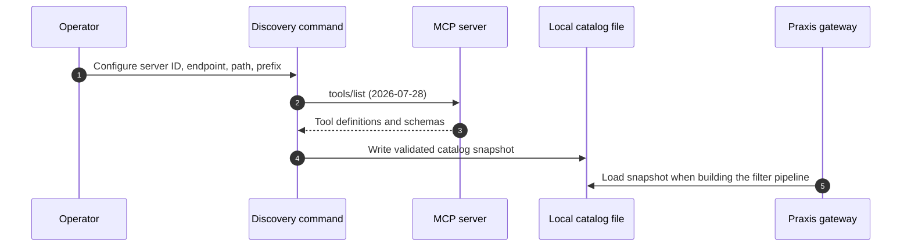
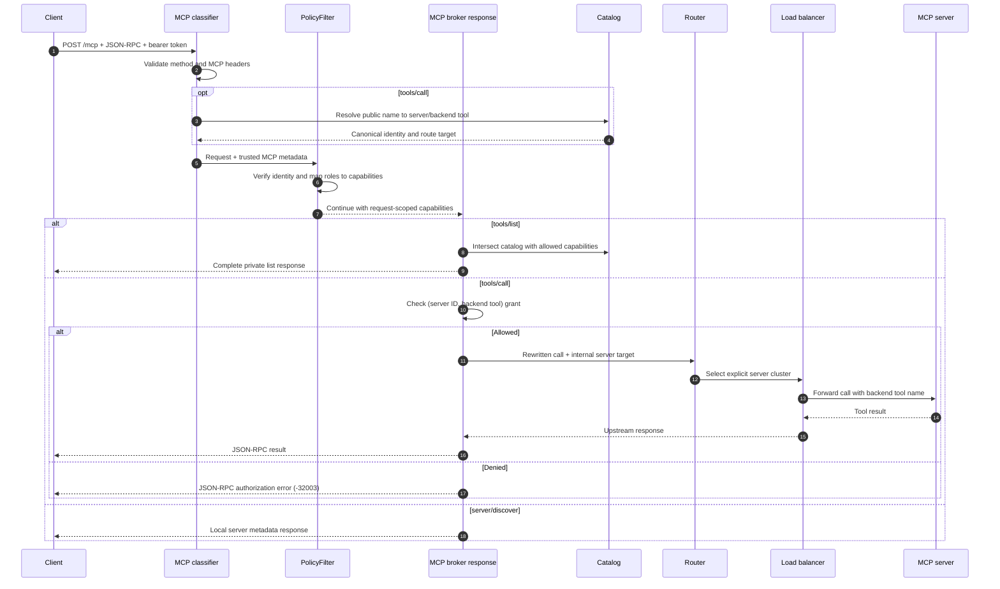

# MCP Gateway

A stateless MCP gateway aggregates configured upstream servers behind one
endpoint for `server/discover`, `tools/list`, and `tools/call`. It publishes a
prefixed catalog, authenticates callers through `PolicyFilter`, filters tool
visibility by request-scoped capabilities, and routes authorized calls to the
selected server clusters.

## Use cases

| Use case | Gateway behavior |
|---|---|
| Aggregate MCP servers | Return one prefixed tool catalog and route each call to its source server. |
| Authenticate callers | Validate the bearer token before serving broker responses or forwarding calls. |
| Authorize tools | Filter `tools/list` by the caller's grants and check every `tools/call` before routing. |

## Server catalog

Discovery runs separately from gateway requests. The POC discovery command
queries each configured server with MCP `2026-07-28`, validates its tools, and
writes a local catalog snapshot. Praxis loads that file when the filter
pipeline is built; refreshing it requires rerunning discovery and restarting
Praxis. The POC has no server-registration API or remote catalog service.

Each catalog entry retains the stable server ID, backend tool name, input
schema, cluster, path, and public prefix. The exposed name combines the prefix
with the backend name: `fastmcp_echo` maps to backend tool `echo` on the
`fastmcp` server. Authorization uses the stable server/tool identity, not the
public name.




## Request processing and routing

The request chain is:

```text
MCP classifier → PolicyFilter → MCP broker response → router → load balancer
```

The classifier validates the stateless JSON-RPC request and MCP headers. It
publishes the method and optional tool name as trusted request metadata. For a
known `tools/call`, it resolves the public name to a catalog entry, rewrites
the body to the backend name, and stages the internal route target. The router
does not run until authorization succeeds.

The `PolicyFilter` validates the bearer token's issuer, audience, and signature
using the configured JWKS. It maps Keycloak realm roles to the authenticated
identity and computes the request's allowed capabilities. The MCP broker then
serves local discovery/list responses or checks a call against those
capabilities before allowing it onward.



`server/discover`, `tools/list`, unknown tools, and denied calls terminate before
the router and do not select a backend. A known, authorized call selects its
explicit cluster; there is no default cluster.

## Filter-chain configuration

The classifier and broker are stages of one filter chain. Both load the same
catalog, with `PolicyFilter` between them.

### MCP classifier

```yaml
- filter: mcp_poc
  stage: classify
  catalog_path: dev/mcp-poc/catalog.json
  path: /mcp
  cache_scope: private
  cache_ttl_ms: 300000
  max_body_bytes: 1048576
```

### MCP broker response

```yaml
- filter: mcp_poc
  stage: respond
  catalog_path: dev/mcp-poc/catalog.json
  path: /mcp
  cache_scope: private
  cache_ttl_ms: 300000
  max_body_bytes: 1048576
```

## Tool authorization

`PolicyFilter` invokes PPE's `identity/jwt` plugin to validate the bearer token
and map claims into a normalized identity. With Keycloak's
`claim_mapper: keycloak`, this configuration maps realm roles to
`subject.roles`.

The policy file has two consumers. Praxis's `PolicyFilter` extracts the
top-level `mcp_authorization` host extension, then passes the remaining APL
document to PPE. Praxis code maps verified roles to grants and inserts
`McpAllowedCapabilities` into the request context. The APL evaluator does not
construct capabilities. This is a typed request extension, not string-keyed
filter metadata or a client header.

```yaml
mcp_authorization:
  role_grants:
    mcp-tools-all:
      - server: "*"
        tool: "*"
    mcp-tool-fastmcp-echo:
      - server: fastmcp
        tool: echo
```

For `tools/call`, the APL policy also requires an authenticated identity; that
allow/deny check does not produce the capability set. `tools/list` passes
identity admission, then the same `PolicyFilter` host mapping supplies its
capabilities. The broker consumes only the typed result and does not know
Keycloak, role names, or the grant configuration.

For the restricted role, the capability value is equivalent to:

```rust
use praxis_filter::McpAllowedCapabilities;

let allowed = McpAllowedCapabilities::from_grants([
    ("fastmcp".to_owned(), "echo".to_owned()),
]);
assert!(allowed.allows("fastmcp", "echo"));
assert!(!allowed.allows("everything", "get-sum"));
```

The Keycloak preset maps realm roles, not per-client
`resource_access.<client-id>.roles`. To use those client roles, the identity
plugin requires an explicit `claim_map`. Grants from all mapped roles are
combined; `*` matches a whole server or tool coordinate. A user with no
matching grant sees no tools and cannot call one directly. User-filtered lists
use private cache scope.

## Telemetry

The opt-in `mcp-poc-filter` feature registers the broker. The `opentelemetry`
feature enables Praxis core OTLP export and Praxis AI semantic spans. The
local POC config sets the OTLP endpoint, service identity, and sampling rate:

```yaml
telemetry:
  otlp_endpoint: "http://127.0.0.1:4317"
  batch_interval_secs: 1
  sampling_rate: 1.0
  service_name: praxis-mcp-poc
  service_version: "0.11.0"
  environment: local
```

OTLP uses gRPC by default. `OTEL_EXPORTER_OTLP_ENDPOINT` supplies a fallback
endpoint when `otlp_endpoint` is unset; set
`OTEL_EXPORTER_OTLP_PROTOCOL=http/protobuf` to use HTTP/protobuf. A W3C
`traceparent` propagates or supplies a parent context; it does not enable
exporting. The POC samples root requests and honors the sampled flag on an
incoming parent.

The MCP filter emits two child spans:

- `mcp_poc.classify` records the bounded `mcp.method` and `mcp.outcome` (`route`
  or `respond`). For a catalog-routed call, it also records the validated public
  tool name in `mcp.tool` and backend tool name in `mcp.backend.tool`.
- `mcp_poc.respond` records the bounded method and outcome (`forward`, `deny`,
  or `local_response`) while it serves the local response or checks a call.

The method label is limited to `server/discover`, `tools/list`, `tools/call`,
or `other`. The MCP spans omit JSON-RPC IDs, request bodies, tool arguments,
credentials, and results. Praxis core adds the inbound HTTP span and, for a
forwarded call, the outbound request spans. The policy filter does not create a
dedicated authorization span.

The restricted-user `tools/list` trace from a smoke run is
`b43521f2af1caec5f3e69522eb2e1785` (trace IDs change between runs). Its
`mcp_poc.respond` span contains the event `filtered MCP tools/list by
authorization`, with `operation=tools/list`, `tools_before=24`, and
`tools_after=1`. The forwarded FastMCP call trace is
`3cf5f0740bb8affaa05c8628e267940e`.

Praxis core exposes HTTP request and upstream metrics. This PromQL query shows
request counts by method, status class, and cluster:

```promql
sum by (method, status_class, cluster) (
  praxis_http_requests_total{job="praxis"}
)
```

There is no MCP-specific Prometheus authorization metric; the list-filter
counts are recorded in the trace event. Policy-filter authorization events
also flow to logs at their configured tracing levels.
