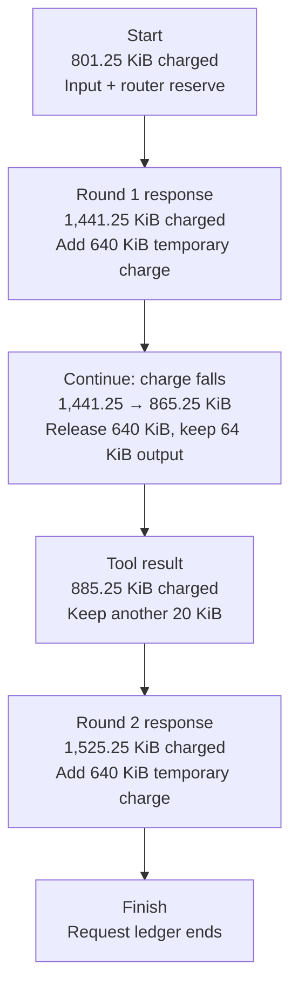

# OpenAI Responses retained-payload budget

The Responses agentic loop can hold several representations of one request at
once: the raw JSON body, parsed input, restored history, rewritten model input,
tool results, streaming events, and a response prepared for storage. Each can
fit its own size limit while their combined payload grows across inference
rounds. `openai_agentic_loop.max_retained_bytes` bounds that request's charged
payload before another representation is created.

For example, a request with a modest prompt can load earlier messages, receive
a model tool call, retain a search result, and send that result back to the
model. The prompt, history, tool result, and response may all be live together.
The budget follows the whole exchange rather than restarting for each round.

The ledger distinguishes two payload lifetimes. **Retained** charges survive
inference rounds: the prompt, restored history, tool results, and output items
kept for the final response. Some output items also become input history for
the next model call. **Round-local** charges cover one round's buffered provider
body or its raw SSE transport and parsed frames. When the loop decides to run
another round, it charges the output items that survived and removes the
round-local charge. The router then discards the round's response before the
next inference request. The next round reuses the released headroom; retained
history and output still accumulate toward the limit.

For example, after the first tool call, the result remains in the model-facing
history and the public output list. The temporary tool transport and the first
model response need not be charged as if they remained live throughout the
second tool call. The ledger keeps charges for the result and output list,
releases the completed round's provider charge, then reserves headroom for the
second round. A model reply does **not** reset the entire request budget.
The separate iterative-router buffer reserve remains charged throughout the
request. On a terminal or failed round, there is no next inference round to
reuse headroom; the remaining round-local charge ends with the request.

### One request across two rounds

Using the worked example below, the request makes one tool call and finishes
after the second model reply. The total **falls between rounds** because the
first provider response's temporary charge is released. Its surviving output
remains charged.



The 576 KiB drop at **Continue** is the 640 KiB provider charge released minus
the 64 KiB output charge retained for later rounds. Response 2 ends the
request, so its temporary charge stays until the ledger is dropped. If round 2
also calls a tool, the same release and retain step repeats before round 3.

## Scope and configuration

The budget applies to managed `POST /v1/responses` creates on a listener with a
reachable `openai_agentic_loop`. An explicit `POST /v1/responses/compact` on
that listener starts its own budget. Other operations such as response fetch
and delete do not start a request ledger. Filters that are not configured in
the request path add no charge for their work.

```yaml
- filter: openai_agentic_loop
  max_infer_iters: 10
  max_retained_bytes: 67108864 # 64 MiB
```

`max_retained_bytes` defaults to 64 MiB and accepts values from 4 KiB through
256 MiB. It cannot be disabled on a configured agentic loop. If several loops
are reachable on one listener, the smallest configured value applies. The
default has the same numeric value as core's `MAX_JSON_BODY_BYTES`; these are
independent limits with different purposes. See the [agentic-loop example] and
the generated [filter configuration reference].

`max_infer_iters` is a separate round-trip limit: it defaults to 10 and must
be between 1 and the core iterative-router ceiling of 100. Raising it permits
more rounds, but does not reset or enlarge the retained-payload budget.
Configure the router's `max_iterations` to allow the initial inference step
plus the intended continuations, as shown in the [agentic-loop example].

At pipeline build, the server installs the policy before request filters run.
It clamps the listener's raw request-body limit to at most one thirty-second
of the retained limit, and the buffered iterative-router response limit to at
most one eighth. With the default, these transport limits are at most 2 MiB
and 8 MiB respectively. The raw request cap applies to **other routes on the
same listener too**. A dedicated listener avoids imposing it on unrelated
traffic. The iterative router must contain the loop in a bounded step.

## What the ledger tracks

The ledger charges payloads owned during one budgeted Responses request. A
reference in the incoming JSON is distinct from content the proxy later loads
for that reference. Only filters on the configured request path add their
charges.

| Payload | What is charged | Lifetime |
| --- | --- | --- |
| Incoming request | The raw JSON body and an allowance for its parsed structure. An inline `file_data` value or a `file_id` string is part of this body. | Retained across inference rounds. |
| Restored history | Budgeted Store reads for `previous_response_id` or a conversation. The Store accounts for serialized JSON bytes and JSON structure before decoding, then the ledger reserves the admitted charge once before replay state is built. | Retained across inference rounds. Reading a response or conversation without creating a new budgeted request does not use this ledger. |
| Resolved files | When `openai_file_resolve` fetches a `file_id` or resolves a `file_url`, the file content, metadata, resolution results, and expanded request body. The `file_id` string alone does not charge the file's contents; a reference passed through without fetching has no fetched-content charge. | Fetched content and rewritten request projections remain charged while the request uses them. |
| Extracted documents | When `openai_doc_extract` converts supported text-safe inline `input_file` content to text, the decoded text, rewritten body, and corresponding history projections. | Retained across inference rounds. |
| Provider response | A buffered response body, or incoming SSE chunks and parsed frames. The ledger also reserves for the iterative router's response buffer. | Provider body and stream charges are round-local and are released on continuation; the router reserve lasts for the request. |
| Kept output and tools | Output items kept for the final response or replay, plus configured MCP discovery and calls, hosted search results, approvals, and model-facing and public tool output. | Kept output and tool results accumulate across rounds; temporary callout reservations can be settled after their owners are dropped. |
| Rewrites and completion | Configured model rewrites, prompt enrichment, Responses-to-Chat translation, Store input and output projections, and conversation append-back. Explicit compaction has its own budget for restored history and summarization. | Charged while their request-side owners are live. Store adds projections when `store` is omitted or `true`. |

This inventory describes **accounting allowances**, not measured allocations.
It does not measure process memory or add together separate requests. Per-file,
body, tool, and Store limits still apply independently.

### How charges are calculated

The transport caps limit bytes received on the wire. The request ledger then
reserves headroom for overlapping raw, parsed, rewritten, and serialized
representations. A multiplier is a **conservative accounting allowance**, not
a count of copies actually made or a measurement of allocated memory. It
leaves room for JSON objects, collection spare capacity, and temporary values
that coexist while filters transform a payload.

For a JSON body with `B` wire bytes and `E` counted JSON syntax elements:

| Owner | Charge reserved by the ledger | Why |
| --- | --- | --- |
| Initial request body | `32 × B + 256 × E` bytes | Covers the raw and parsed input and temporary request-side representations. |
| A round's buffered provider response (round-local) | `64 × B + 8,192 × E` bytes; another equal charge with Store | Covers the raw body, parsing, and transient response-state representations for one round. The loop replaces this charge with the surviving output charge when it continues. Small JSON values can still require allocated map or vector capacity. |
| Retained output per continued round | `32 × O` bytes for the `O` serialized bytes the round keeps in `accumulated_output`; another `16 × O` with Store | Kept items stay in the final output list; some also enter model-facing history. These charges accumulate across continued rounds. A terminal round keeps its round-local charge until the request ends. |
| Store input | Another charge equal to the initial request-body charge | Reserves for the independently owned input snapshot when `store` is omitted or `true`. `store: false` avoids this and the Store output charges above. |
| Streamed provider response (round-local) | `32 × C` for cumulative raw SSE bytes `C`, plus `512 × F` for counted JSON elements `F` in completed frames; Store adds `32 × C + 256 × F` | Covers the stream's transport and parsed frames for this round. Each incoming chunk also checks a temporary `16 × chunk bytes` peak; that peak is not accumulated. |
| Iterative-router response buffer | `3 × (limit ÷ 8)` bytes | Reserves for the core buffer and possible spare capacity before the provider responds. This is 24 MiB at the default 64 MiB limit. |

For a create that restores history, Store receives the remaining ledger
allowance. Before decoding, each backend preflights raw JSON byte lengths and
scans the JSON structure. A response or conversation is charged
`32 × B + 8,192 × E`, where `B` is the serialized JSON payload bytes and
relevant record identifiers, and `E` counts JSON containers, keys, and scalar
values. The backend returns the measured charge; rehydration reserves it once
before it creates replay projections. These values are conservative accounting
allowances, not measured allocations.

Conversation append-back checks the new items it writes and any legacy prefix
that must be read and wrapped during its first item append. Existing item rows
are not read or rebuilt by append-back, so their history is not charged a
second time at that boundary. Explicit compaction keeps its separate ledger
and 512× Store-read allowance. These caps apply to charged payload, not the
entire database or process memory.

`E` counts parts **inside the JSON document**, not physical servers or
machines. It includes the start of each object or array, each key string,
and each string, number, boolean, or `null` value. For example,
`{"input":"hi","store":false}` has five counted elements: the object,
the `input` key, the `hi` value, the `store` key, and the `false` value.
Commas and colons do not count. A scanner counts these elements directly
from borrowed bytes before JSON parsing. This matters because a short JSON
body with thousands of tiny values can require substantially more allocated
structure than its wire length suggests.

For example, suppose the configured limit is 64 MiB and a create body is
512 KiB with 10 counted JSON elements. Its initial charge is
`(32 × 512 KiB) + (256 bytes × 10)` = **16 MiB + 2.5 KiB**.
The router reserve adds **24 MiB**. With omitted `store`, the Store input
projection adds the same input charge again. The ledger therefore starts at
**56 MiB + 5 KiB**, leaving just under **8 MiB** for history, tool work,
output, and other owners. With `store: false`, it starts at
**40 MiB + 2.5 KiB**. These are reserved charges,
not a claim that the process has allocated those exact amounts.

The same distinction applies to output. A hypothetical 1 KiB buffered
response with 10 counted JSON elements needs
`(64 × 1 KiB) + (8,192 bytes × 10)` = **144 KiB** while that round is
processed, or **288 KiB** with Store. Suppose 512 bytes of output items survive
in `accumulated_output`. On continuation, the ledger replaces the 144 KiB
round-local charge with `32 × 512` = **16 KiB** of retained charge. With Store,
it replaces 288 KiB with `(32 + 16) × 512` = **24 KiB**. The next round can use
the released headroom, while the 16 KiB or 24 KiB continues to count.

Here is a simplified ledger simulation for a two-round request with
`store: false` and a **2 MiB** limit. Assume a 1 KiB input body with five
counted JSON elements, two 8 KiB provider responses with 16 counted elements
each, and 2 KiB of output items kept from the first round. The second round
finishes the request. The tool result adds an illustrative 20 KiB retained
charge after its temporary callout allowance is
settled. An actual tool request also incurs charges for tool declarations,
dispatch, and any configured request filters. These are **ledger charges**,
not measured heap usage or a complete HTTP fixture.

| Step | Retained and fixed reserves | Current round charge | Total charged |
| --- | ---: | ---: | ---: |
| Admit input and router buffer | 801.25 KiB | 0 | 801.25 KiB |
| Parse model response 1 | 801.25 KiB | 640 KiB | 1,441.25 KiB |
| Continue: keep output 1, release response 1 | 865.25 KiB | 0 | 865.25 KiB |
| Keep tool result | 885.25 KiB | 0 | 885.25 KiB |
| Parse model response 2 | 885.25 KiB | 640 KiB | 1,525.25 KiB |

The opening charge is `32 × 1 KiB + 256 × 5` = **33.25 KiB** for input,
plus `3 × (2 MiB ÷ 8)` = **768 KiB** for the router buffer. Each model response
adds `64 × 8 KiB + 8,192 × 16` = **640 KiB**. The first continuation
replaces that charge with `32 × 2 KiB` = **64 KiB** for the output items it
keeps. If response 1's temporary charge remained alongside those kept items,
the second response would bring this simplified example to **2,165.25 KiB**,
above the 2,048 KiB limit. With the release, response 2 is charged at
**1,525.25 KiB**, while the previous output and tool result continue to
count. Because response 2 ends the request, its round-local charge is not
released for another round; it disappears when the request ledger is dropped.

Streaming uses the chunk and frame charges in the table instead of the
buffered-response formula. On continuation, surviving output gets the same
`32 × O` retained charge (plus `16 × O` with Store), while that round's
transport and frame charge is removed. At logical-stream completion, the
terminal response adds a separate `4 ×` serialized-output allowance (plus
`2 ×` with Store) for the response encoding and Store copy. Request-side
filters likewise reserve their specific expansions before creating them and
can settle temporary headroom after intermediate values are released.

The configured number is a ceiling for the **accounting model**, not a
promise that a raw body of that size will be accepted. It can be exhausted
below either transport cap when the request has many JSON elements, restored
history, tool results, or several simultaneously live payload owners.

## Request flow and ownership

1. `openai_responses_request` preflights the create body before its JSON parse
   and places a request-scoped ledger in `ResponsesState`. Earlier rewrites
   must also preflight the body before their own parsing or expansion.
2. Request filters reserve headroom before rewriting input, loading history,
   decoding files, or discovering tools. An explicit compaction request has a
   separate ledger for its Store reads and summarization callout.
3. `openai_agentic_loop` admits each buffered provider response before parsing
   it. For streaming, `openai_stream_events` charges chunks before assembling
   frames, then charges completed frames and the terminal response. These
   per-round provider charges are round-local: when the loop continues to the
   next round, the loop retains the output the round left in `accumulated_output`
   and removes its round-local body, transport, and frame charges. The router
   discards the previous response before the next inference request. Retained
   input, history, tool results, and output persist across iterative-router
   rounds.
4. Tool dispatchers reserve callout and result headroom before executing
   calls. The loop owns one canonical output list; dispatchers identify their
   assigned item by index and ID and update it instead of keeping a second
   full output tree.
5. Conversation append-back and response persistence account for their own
   retained representations before reporting a completed response.

The ledger reserves conservatively before an allocation or callout and can
settle temporary headroom after an intermediate value is released. It tracks
explicitly charged payload owners. It does not measure process RSS, include
every allocator overhead, or sum memory across concurrent requests. Other
request limits, transport caps, and operational capacity controls still apply.

## Filter responsibilities

| Stage | Filter | Budget responsibility |
| --- | --- | --- |
| Admission | [`openai_responses_request`] | Preflight the raw create body and attach the ledger to canonical request state. |
| Input rewrite | [`openai_responses_model_rewrite`] | Reserve the parsed and rewritten model/body projection before changing an alias. |
| Input rewrite | [`prompt_enrich`] | Charge configured prompt additions and the resulting request body. |
| Input rewrite | [`openai_doc_extract`] | Reserve decoded documents, rewritten text, body serialization, and history projections. |
| Input rewrite | [`openai_file_resolve`] | Bound file retrieval and charge content plus the rewritten request. Budget exhaustion remains terminal even with permissive file-error handling. |
| History | [`openai_responses_rehydrate`] | Bound Store reads before decoding previous responses or conversation history; charge replay state. |
| History | [`openai_responses_compact`] | Bound stored history and summarization output; charge source, summary, and persistence projections. |
| Tool preparation | [`openai_client_tool_compat`] | Charge the extra request and response forms used when lowering client tools to backend functions. |
| Tool preparation | [`openai_mcp_tool_resolve`] | Bound eager or deferred `tools/list` discovery, parsed listings, tool maps, and expanded declarations. |
| Loop | [`openai_agentic_loop`] | Charge each round's buffered body as round-local; at the round boundary retain the surviving output and release the round-local charge. Own the loop decision and terminal failure. |
| Streaming | [`openai_stream_events`] | Charge SSE chunks and assembled frames as round-local and the terminal output as retained; local tool-event synthesis is retained output. The loop releases the round-local stream charge at each round boundary. |
| Tool execution | [`openai_mcp_dispatch`] | Reserve in-flight MCP results and approval data; bound transport and parsing before call results enter state. |
| Tool execution | [`openai_file_search_dispatch`] | Charge search fanout, raw and parsed results, model context, public output, and citations. |
| Tool execution | [`openai_web_search_dispatch`] | Limit provider response bytes from remaining headroom and charge results and both model-facing and public output. |
| Translation | [`openai_responses_to_chat_completions`] | Charge translated Chat requests and responses, including streaming converter frames and snapshots. |
| Completion | [`openai_conversations`] | Reserve the completed turn and bound transactional conversation-cache rebuild before append-back. |
| Completion | [`openai_responses_store`] | Bound buffered output, require the ledger before input capture, and skip success persistence after budget failure. |
| Compatibility | [`anthropic_web_search`] | Treat the shared provider's new retained-limit outcome as a failed tool result; Anthropic requests do not use this ledger. |

The Store backends support bounded response and conversation reads, bounded
conversation append, and size-only pending-approval checks. Budgeted MCP calls
use bounded transport and fresh sessions so a pooled session cannot retain an
incompatible response limit. The shared web-search provider reports retained
limit exhaustion separately from ordinary provider failure.

## When the budget is exhausted

| Point of failure | Client-visible result | Further work |
| --- | --- | --- |
| Initial request admission or request-side expansion before inference | Responses-formatted HTTP `413` | The oversized work is not sent to inference. |
| Buffered inference or continuation output | Responses-formatted HTTP `502` | No successful final response is persisted. |
| After streaming response headers have committed | One terminal SSE `error` while HTTP remains `200` | No successful completion event or response persistence follows. |

Some request-side failures during a later tool or history continuation are
converted by the loop's terminal owner, so the exact response depends on
whether a stream has already committed. An exhausted budget does not wait for
another request, refill over time, or shed a different active request. Each
new request gets its own ledger and is admitted or rejected on its own work.

The [agentic-loop integration tests] exercise admission before inference,
buffered output overflow, streaming terminal errors, Store and conversation
behavior, restoration, and tool paths. They test protocol outcomes; they are
not measurements of whole-process peak memory under concurrent load.

[agentic-loop example]: ../../examples/configs/openai/responses/agentic-loop.yaml
[filter configuration reference]: ../filters/openai_agentic_loop.md
[agentic-loop integration tests]: ../../tests/integration/tests/suite/examples/openai_agentic_loop.rs
[`openai_responses_request`]: ../filters/openai_responses_request.md
[`openai_responses_model_rewrite`]: ../filters/openai_responses_model_rewrite.md
[`prompt_enrich`]: ../filters/prompt_enrich.md
[`openai_doc_extract`]: ../filters/openai_doc_extract.md
[`openai_file_resolve`]: ../filters/openai_file_resolve.md
[`openai_responses_rehydrate`]: ../filters/openai_responses_rehydrate.md
[`openai_responses_compact`]: ../filters/openai_responses_compact.md
[`openai_client_tool_compat`]: ../filters/openai_client_tool_compat.md
[`openai_mcp_tool_resolve`]: ../filters/openai_mcp_tool_resolve.md
[`openai_agentic_loop`]: ../filters/openai_agentic_loop.md
[`openai_stream_events`]: ../filters/openai_stream_events.md
[`openai_mcp_dispatch`]: ../filters/openai_mcp_dispatch.md
[`openai_file_search_dispatch`]: ../filters/openai_file_search_dispatch.md
[`openai_web_search_dispatch`]: ../filters/openai_web_search_dispatch.md
[`openai_responses_to_chat_completions`]: ../filters/openai_responses_to_chat_completions.md
[`openai_conversations`]: ../filters/openai_conversations.md
[`openai_responses_store`]: ../filters/openai_responses_store.md
[`anthropic_web_search`]: ../filters/anthropic_web_search.md
